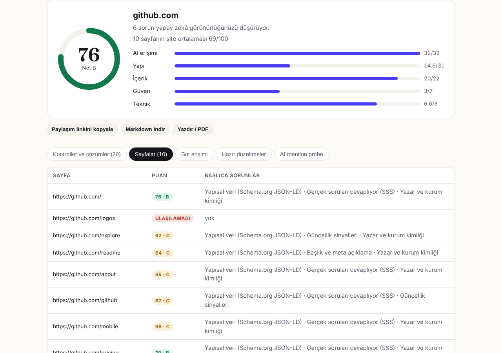

# Citeable

**Get recommended by ChatGPT, Claude, Perplexity and Google AI Overviews.**

Citeable is an open-source **GEO (Generative Engine Optimization)** toolkit. It audits how AI assistants see your website, scores it across 20 weighted checks, and generates the exact fixes: `llms.txt`, Organization JSON-LD and `robots.txt` rules. The optional **AI Mention Probe** asks an AI model the questions your buyers ask and measures your share of voice.


## Why

Search is moving from ten blue links to one synthesized answer. If an assistant cannot crawl, parse or trust your site, it recommends someone else, and you never see the lost click. SEO tools measure rankings; Citeable measures whether **AI can cite you**.

## Features

| Area | What Citeable checks |
| --- | --- |
| **AI access** | robots.txt against 14 AI agents (OAI-SearchBot, ChatGPT-User, GPTBot, Claude-SearchBot, Claude-User, ClaudeBot, PerplexityBot, Perplexity-User, Googlebot, Google-Extended, Bingbot, Applebot-Extended, meta-externalagent, CCBot). Search and training bots are scored separately. Also `llms.txt`, sitemap and noindex. |
| **Structure** | Schema.org JSON-LD types, FAQ content, heading hierarchy, title/description, Open Graph, canonical and `lang`. |
| **Content** | Text visible **without JavaScript**, lists and tables an LLM can quote, freshness dates, statistics and outbound citations. |
| **Trust** | Author and organization identity, About and Contact pages. |
| **Technical** | HTTPS, response time, image alt text. |
| **Fix generator** | Drafts `llms.txt` from your navigation, Organization + WebSite JSON-LD with `sameAs` links, and robots.txt rules for AI search crawlers. |
| **Whole-site scan** | Crawls up to 10 pages from your sitemap (or homepage links) and ranks them by score, so you see which pages drag visibility down. |
| **Share & export** | Shareable report links (`/?url=example.com`), Markdown download, print-ready PDF, and an embeddable score badge. |
| **English & Turkish** | Full UI and reports in both languages (`/` and `/tr`), with hreflang, localized errors and auto-detection in the API. |
| **AI Mention Probe** | Runs up to 5 buyer questions through Claude, then reports whether you are mentioned, your rank, and the competitors recommended instead. |
| **Lead capture** | Pricing and in-report waitlist forms post to `/api/lead` and forward to any webhook (Zapier, Make, n8n…). |

## Quick start

```bash
npm install
npm run dev            # http://localhost:3000
```

Command line, which also works as a CI gate:

```bash
npm run audit -- example.com
npm run audit -- example.com --json
npm run audit -- example.com --min-score=70   # exits 1 below the threshold
npm run audit -- example.com --pages=10 --lang=tr --markdown > rapor.md
```

HTTP API:

```bash
curl -X POST localhost:3000/api/audit -H 'content-type: application/json' \
  -d '{"url":"example.com","lang":"tr","pages":10,"format":"markdown"}'
```

| Endpoint | Purpose |
| --- | --- |
| `POST /api/audit` | `{ url, lang?: "en" \| "tr", pages?: 1-10, format?: "json" \| "markdown" }`. Results are cached for 10 minutes. |
| `GET /api/badge?url=example.com` | SVG score badge, CDN-cacheable for a day. |
| `POST /api/lead` | `{ email, plan, site?, lang? }` → forwarded to `LEAD_WEBHOOK_URL`. |
| `POST /api/probe` | AI Mention Probe (requires `ANTHROPIC_API_KEY`). |

### Environment variables

| Variable | Purpose |
| --- | --- |
| `ANTHROPIC_API_KEY` | Enables the AI Mention Probe. |
| `CITEABLE_PROBE_MODEL` | Model for the probe (default `claude-opus-5-5`). |
| `LEAD_WEBHOOK_URL` | HTTPS endpoint that receives sign-ups as JSON. |
| `NEXT_PUBLIC_SITE_URL` | Public URL, used for metadata, sitemap and share links. |
| `RATE_LIMIT_PER_HOUR` | Audits per IP per hour (default 20; multi-page scans are limited to 5). |

### AI Mention Probe (optional)

Copy `.env.example` to `.env.local` and set `ANTHROPIC_API_KEY`. The probe uses `claude-opus-5-5` at low effort by default; override with `CITEABLE_PROBE_MODEL`.

## Architecture

```
src/
  lib/audit/      audit engine (framework independent)
    ssrf.ts         URL normalisation + private-network blocking on every redirect hop
    fetcher.ts      capped, timed fetch with a crawler user agent
    robots.ts       RFC 9309 robots.txt evaluation for 14 AI agents
    checks.ts       20 weighted checks (4 site-level, 16 page-level)
    messages.ts     check texts in English and Turkish
    sitemap.ts      sitemap parsing and page selection for multi-page scans
    generators.ts   llms.txt / JSON-LD / robots.txt generators
    markdown.ts     shareable Markdown report
  lib/probe/      AI Mention Probe (Anthropic SDK)
  lib/i18n/       language detection + UI dictionary (en, tr)
  app/(en)        English site at /
  app/(tr)/tr     Turkish site at /tr
  app/api/        audit, badge, lead, probe
  components/     landing page and report UI
  cli.ts          terminal client
tests/            vitest suite with a fake fetch, no network needed
```

Scoring: every check has a weight, and the weights sum to 100. Grade A ≥ 85, B ≥ 70, C ≥ 55, D ≥ 40.

## Deploy

- **Vercel:** import the repo and set `ANTHROPIC_API_KEY` if you want the probe.
- **Docker:** `docker build -t citeable . && docker run -p 3000:3000 citeable`

## Roadmap

- [x] Multi-page crawl from the sitemap
- [x] Turkish localisation
- [x] Shareable reports, Markdown/PDF export, score badge
- [x] Waitlist / lead capture
- [ ] Accounts, saved sites and weekly monitoring (Pro)
- [ ] Stripe billing
- [ ] Probe across several AI providers, with share-of-voice trends
- [ ] White-label reports and API keys (Agency)
- [ ] WordPress / Shopify plugin that applies fixes in one click

## License

[AGPL-3.0](LICENSE). You can self-host and modify Citeable freely. If you offer a modified version as a network service, you must publish your changes. Commercial licenses are available.

---

## 🇹🇷 Türkçe özet

**Citeable**, web sitelerinin yapay zekâ asistanlarında (ChatGPT, Claude, Perplexity, Google AI Overviews) **bulunabilir, anlaşılabilir ve önerilebilir** olup olmadığını ölçen açık kaynak bir GEO (Üretken Motor Optimizasyonu) aracıdır. 20 kontrol yapar, 100 üzerinden puan verir ve düzeltmeleri (llms.txt, JSON-LD, robots.txt) hazır kod olarak üretir. Arayüz ve raporlar tamamen Türkçe de kullanılabilir (`/tr`). İş modeli ve pazar araştırması için: [docs/IS_PLANI.md](docs/IS_PLANI.md).


